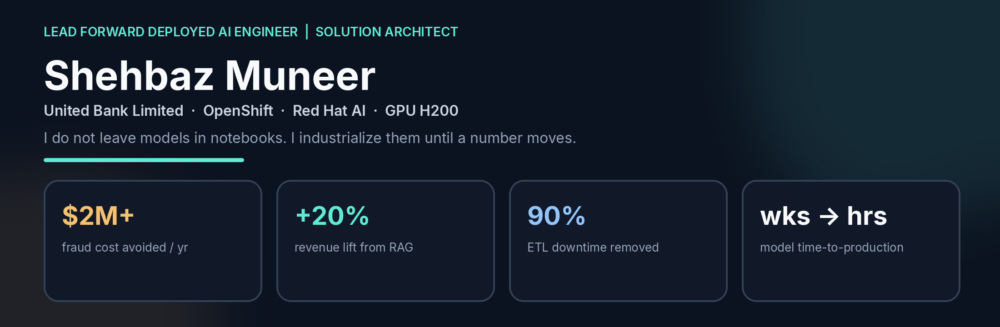
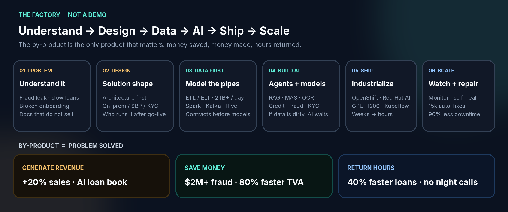
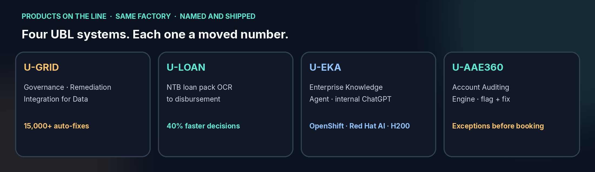
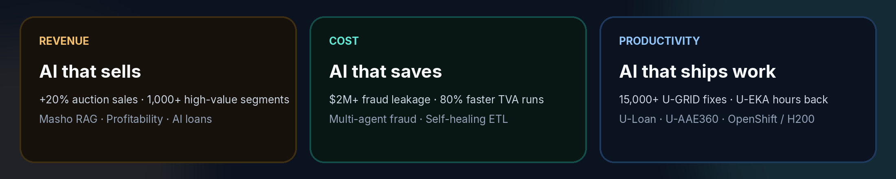
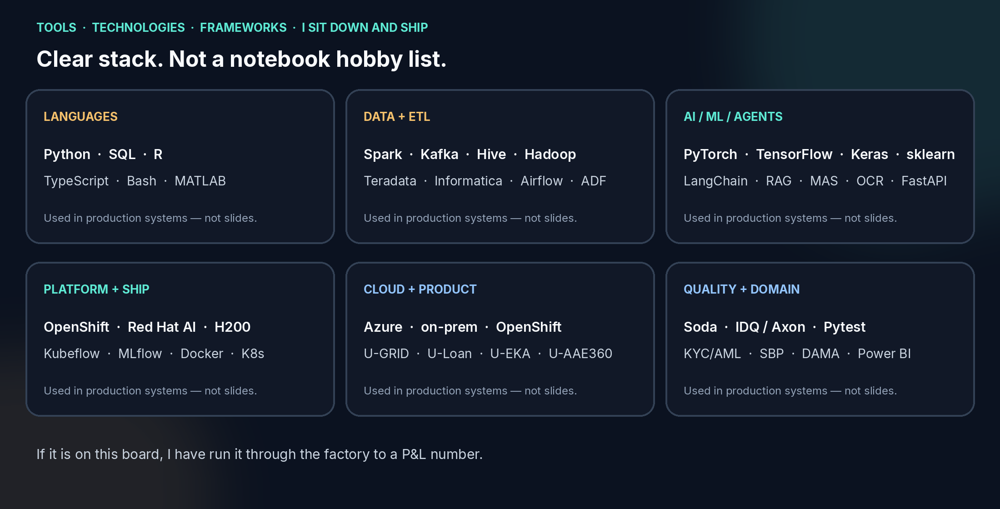
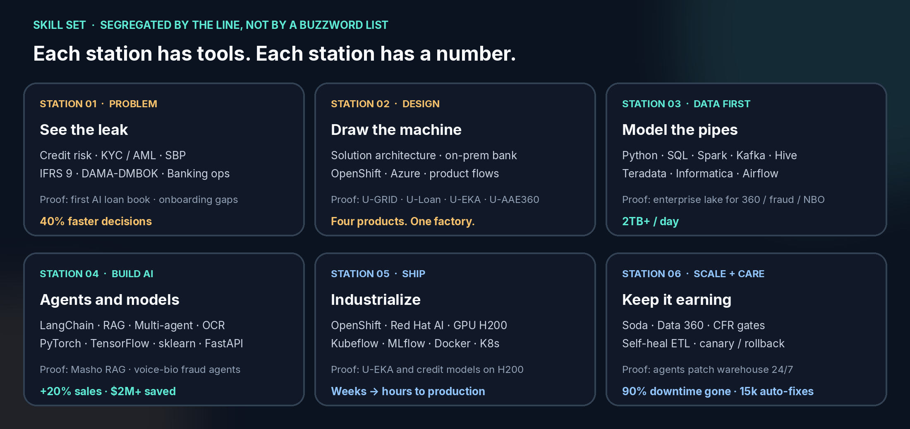

  

 

# Shehbaz Muneer

**Lead Forward Deployed AI Engineer | Solution Architect**  
United Bank Limited · Karachi · OpenShift · Red Hat AI · GPU H200

[LinkedIn](https://www.linkedin.com/in/shehbazmuneer/) · [Email](mailto:muhammadshahbazmuneer74@gmail.com) · [IEEE](https://doi.org/10.1109/IMCERT57083.2023.10075275)

### How I work (and how I do not)

I **do not** have models that live only in a notebook.

I sit with the business as a **Lead Forward Deployed AI Engineer** and **Solution Architect**, then run the same factory every time: understand the problem → design the solution → data-first modeling (ETL) → build the AI (agents / ML) on **OpenShift + Red Hat AI + NVIDIA GPU H200** → industrialize it in production → scale, monitor, and maintain it.

If it cannot survive a real customer, a real auditor, and a real SLA, it is unfinished. The by-product is the only product: **money saved · money made · hours returned**.

---

  

---

  

## What I own on the line right now

<table>
<tr>
<td width="50%" valign="top">

### U-GRID
**Governance, Remediation and Integration for Data**

DAMA / SBP data-governance factory. Agents detect quality and PII breaks, remediate them, and write clean data back — no ticket queue.

- **15,000+** quality / PII violations closed with no ticket  
- RAG over DAMA-DMBOK and SBP mapped to schemas  
- Self-heal: detect → SQL patch → recovered schema  

</td>
<td width="50%" valign="top">

### U-Loan
**NTB customer — loan documents to disbursement**

New-to-bank origination: OCR the full loan pack, complete the case, score it, push money out. Paper is no longer the bottleneck.

- Document OCR + extraction on the NTB loan file  
- **40%** faster decisions vs human queues  
- Pakistan’s first AI loan book — now a product  

</td>
</tr>
<tr>
<td width="50%" valign="top">

### U-EKA
**Enterprise Knowledge Agent — internal ChatGPT for UBL**

One grounded assistant for policy, product, and ops. Served on Red Hat AI / OpenShift with GPU H200 — not a public chatbot on the intranet.

- RAG over internal banking knowledge, not the open web  
- Runs on **OpenShift + Red Hat AI + NVIDIA H200**  
- Hours back from hunting circulars, SOPs, product notes  

</td>
<td width="50%" valign="top">

### U-AAE360
**Account Auditing Engine — flags exceptions and fixes them**

Rules + AI on every account-opening pack. Missing docs, KYC gaps, policy breaks: flag the exception, drive the fix, keep the trail.

- Exceptions found **before** the account is booked  
- Branches fix the right thing once  
- SBP-ready evidence instead of a hunt after the fact  

</td>
</tr>
</table>

---

## Projects that speak in numbers

Same factory. Named products. Each row is a leak run through the line.

| Product / problem | What ran the line | By-product |
| :--- | :--- | :--- |
| **U-GRID** — quality / PII with no owners | **Design** DAMA RAG · **AI** auto-fix agents · **Ship** governance + remediation | **15,000+** fixes, no ticket |
| **U-Loan** — NTB loans stuck in paper | **Data** OCR pack · **AI** extract + score · **Ship** disbursement | **40%** faster decisions · first AI loan book |
| **U-EKA** — knowledge trapped in circulars | **Design** RAG · **Ship** OpenShift / Red Hat AI / **H200** | One internal ChatGPT for UBL · hours returned |
| **U-AAE360** — bad accounts slipping through | **AI** + rules audit · **Scale** flag-and-fix | Exceptions caught **before** booking |
| Fraud calls eating money and time | **Design** MAS · **AI** voice-bio + behavior agents · **Scale** 24/7 | **$2M+ / yr saved** · **40%** fewer false positives |
| Japanese auction docs blocking bids | **Design** OCR+RAG · **Data** 100+ docs/hr ETL · **Ship** Masho | **+20% sales** · **99%** automated |
| Profitability engine too slow to act | **Design** schema rewrite · **Data** Spark / TVA · **Ship** targeting | **80% faster** · **1,000+** high-value customers |
| Night calls when the warehouse broke | **Design** agentic repair · **AI** SQL-patch agents · **Scale** unattended | **90%** downtime gone |
| Models dying in notebooks | **Ship** OpenShift + Red Hat AI + GPU H200 · Kubeflow / MLflow | **Weeks → hours** to production |

  

---

## Skills, tools, technologies, frameworks

This is the board I can sit down and work on — production stack, including the platform the bank actually runs.

  

  

| Layer | What I work in |
| :--- | :--- |
| **Languages** | Python · SQL · R · TypeScript · Bash / Shell · MATLAB |
| **Data engineering & ETL** | Apache Spark / PySpark · Kafka · Hive · Hadoop / HDFS · Teradata · Informatica BDM · Apache Airflow · Azure Data Factory · Dask |
| **Stores & serving** | Oracle · MySQL · Teradata · HBase · ChromaDB (vector) |
| **AI / ML / agents** | PyTorch · TensorFlow · Keras · Scikit-learn · LangChain · RAG · Multi-agent systems · OCR · **Red Hat AI** · **NVIDIA GPU H200** · Ollama / Qwen · FastAPI |
| **Platform & industrialize** | **OpenShift** · **Red Hat OpenShift AI** · **GPU H200** · Kubeflow · MLflow · Docker · Kubernetes · CI/CD · Jenkins · Linux / RHEL · Celery |
| **Cloud & architecture** | Azure · OpenShift on-prem · microservices · Solution architecture · Forward-deployed delivery |
| **Quality, risk, domain** | Informatica IDQ · Axon · Soda · Pytest · Data 360 · KYC / AML · SBP · DAMA-DMBOK · IFRS 9 |
| **Products I ship** | **U-GRID** · **U-Loan** · **U-EKA** · **U-AAE360** · React · Power BI · Tableau |

  

### Same stack, mapped to the factory

| Station | Tools on that station | Number that proves it |
| :--- | :--- | :--- |
| **01 Problem** | Credit risk · KYC / AML · SBP · IFRS 9 · DAMA-DMBOK | U-Loan **40%** faster |
| **02 Design** | Solution architecture · on-prem · OpenShift · product flows | U-GRID · U-Loan · U-EKA · U-AAE360 |
| **03 Data first** | Python · SQL · Spark · Kafka · Hive · Teradata · Informatica · Airflow | **2TB+ / day** |
| **04 Build AI** | LangChain · RAG · Multi-agent · OCR · PyTorch · **Red Hat AI** · **H200** | **+20%** sales · **$2M+** · U-EKA |
| **05 Ship** | **OpenShift** · **Red Hat OpenShift AI** · **GPU H200** · Kubeflow · MLflow | **Weeks → hours** |
| **06 Scale + care** | Soda · Data 360 · U-GRID self-heal · U-AAE360 · canary | **90%** downtime · **15k** fixes |

---

## Path, compressed

| When | Role | Number I left behind |
| :--- | :--- | :--- |
| 2025 – now | **Lead Forward Deployed AI Engineer**, UBL | U-GRID · U-Loan · U-EKA · U-AAE360 · OpenShift / Red Hat AI / H200 |
| 2024 – 2025 | **Data Engineer**, Godai.tech (Japan) | +20% sales · 80% faster profitability · EoQ in 90 days |
| 2022 – 2024 | **Data Engineer**, UBL | 2TB+/day · first AI loan system · OG2→OG1 in 1 year |
| 2020 – 2022 | **Top-Rated consultant**, Fiverr + Eye Interaction | 100+ paid deliveries · 30% more high-value leads |

Runner-up, Pakistan’s first national Datathon (136 universities) — the loan model later went live as **U-Loan** · IEEE IMCERT 2023 · B.S. Computational Finance, NED

---

  
  

---

**Problem in. Factory on. By-product out: money saved · money made · hours returned.**

[LinkedIn](https://www.linkedin.com/in/shehbazmuneer/) · [muhammadshahbazmuneer74@gmail.com](mailto:muhammadshahbazmuneer74@gmail.com)

